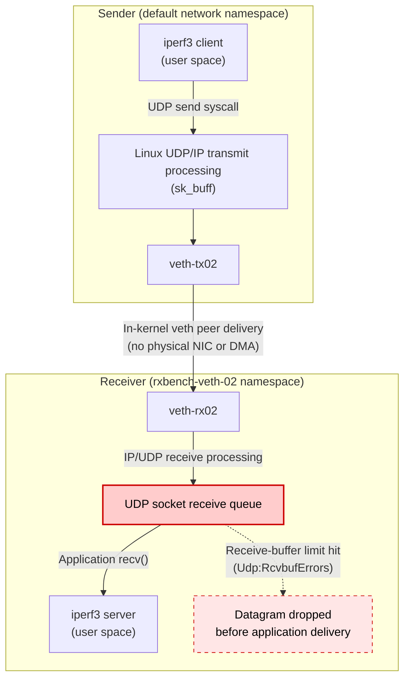
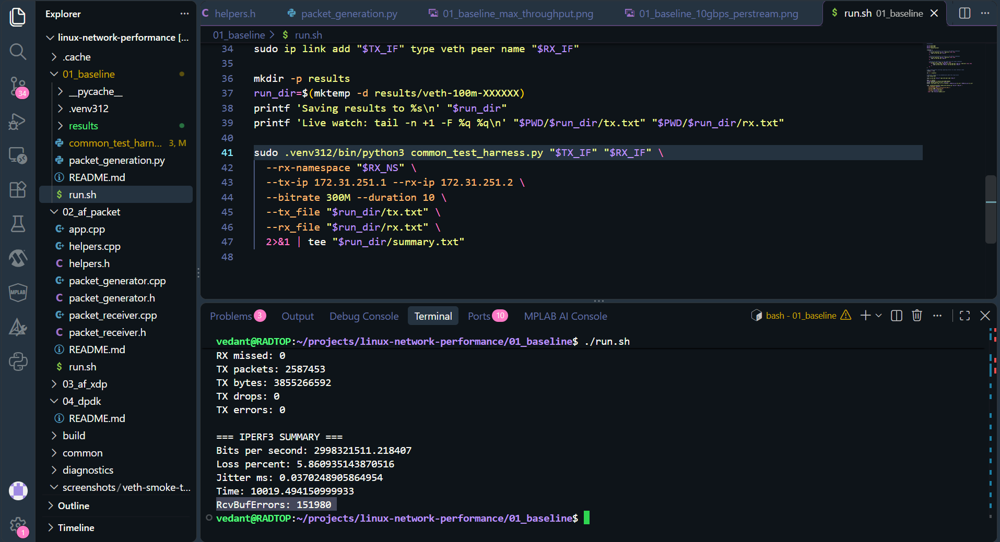

# Stage 1 — UDP Throughput and Packet Loss

Stage 1 measures UDP throughput and packet loss between two Linux interfaces. The Python harness runs iperf3, records host counters along the packet path, and publishes TX and RX snapshots to a live Streamlit dashboard. The current launcher runs on a virtual Ethernet pair. A physical 10 GbE switch test is planned.

[Watch the Stage 1 dashboard demo](../screenshots/veth-smoke-tests/linux_network_performance_stage1_demo.mp4).

## What the tool reports

| Source | Measurements |
| --- | --- |
| iperf3 sender and receiver | Sender bitrate and datagrams sent, receiver goodput, datagram loss count and percentage, and jitter. |
| Linux interfaces and TX queue | TX/RX packet and byte counts, interface drops and errors, and TX qdisc drops, backlog, and requeues. |
| Linux UDP receive path | Post-run cumulative `Udp:RcvbufErrors` from `/proc/net/snmp` in the veth receiver namespace. |
| Live dashboard | TX and RX throughput from interface byte-counter deltas, raw and smoothed traces, and per-interval interface and qdisc drop counters. |

Use the iperf3 receiver summary for end-to-end datagram loss. Read interface and qdisc drop series by checkpoint because their scopes can overlap. The dashboard currently tracks Linux counters. UDP receive-buffer errors are reported in the terminal summary, and switch-port collection is planned.

## UDP packet path



## Virtual Ethernet smoke tests

The bitrate-targeted and unpaced trials ran on one Linux host. The iperf3 client sent from `veth-tx02` in the default network namespace to its virtual peer `veth-rx02` in `rxbench-veth-02`. The veth pair forwards traffic inside the Linux kernel. The traffic path used no physical NIC, PHY, cable, or external switch. Each trial used Python 3.12 and a 10 s test duration.

| Metric | 100 Mb/s, 1 stream | 1 Gb/s, 1 stream | 10 Gb/s, 1 stream | 10 Gb/s, 4 streams |
| --- | ---: | ---: | ---: | ---: |
| Configured UDP target per stream | 100 Mb/s | 1 Gb/s | 10 Gb/s | 2.5 Gb/s |
| iperf3 reported aggregate UDP bitrate | 99.995 Mb/s | 979.982 Mb/s | 1,061.699 Mb/s | 2,604.348 Mb/s |
| iperf3 reported UDP loss | 0.126% | 0.316% | 0.653% | 0.171% |
| iperf3 reported UDP jitter | 0.130 ms | 0.022 ms | 0.013 ms | 0.023 ms |
| Interface drops and errors | 0 on TX and RX | 0 on TX and RX | 0 on TX and RX | 0 on TX and RX |
| Median gap between logged snapshots (TX / RX) | 10.002 / 9.999 ms | 10.000 / 10.000 ms | 9.999 / 10.000 ms | 10.000 / 10.000 ms |
| Longest gap between logged snapshots (TX / RX) | 63.932 / 62.982 ms | 34.962 / 38.537 ms | 32.290 / 34.122 ms | 50.781 / 42.418 ms |

Bitrate, loss, jitter, and interface counters come from the terminal summaries. The historical runner read iperf3's aggregate `end.sum` field. The current runner reads `end.sum_sent` and `end.sum_received` separately. Snapshot gaps in the table use adjacent timestamps in the saved TX and RX logs. At the same 10 Gb/s aggregate target, the four-stream smoke test reported 2.45× the bitrate of the single-stream smoke test and reached 26.0% of the target.

iperf3 estimates UDP loss from sequence gaps at the receiving application. Linux `tx_dropped` and `rx_dropped` cover interface checkpoints. A datagram can reach the RX interface and then be discarded at the UDP socket queue. The original trial logs contain interface snapshots with independent TX and RX boundaries, so the exact location of those losses remains unverified. [iperf3 UDP loss accounting](https://github.com/esnet/iperf/discussions/1680) · [Linux interface counter definitions](https://docs.kernel.org/networking/statistics.html#struct-rtnl-link-stats64)

| Aggregate UDP target and stream count | Terminal summary | Counter logs | Screenshot |
| --- | --- | --- | --- |
| 100 Mb/s, 1 stream | [Summary](results/veth-100mbps-target-1-stream/summary.txt) | [TX](results/veth-100mbps-target-1-stream/tx.txt) · [RX](results/veth-100mbps-target-1-stream/rx.txt) | [100 Mb/s veth smoke test](../screenshots/veth-smoke-tests/01_baseline_100_mbps.png) |
| 1 Gb/s, 1 stream | [Summary](results/veth-1gbps-target-1-stream/summary.txt) | [TX](results/veth-1gbps-target-1-stream/tx.txt) · [RX](results/veth-1gbps-target-1-stream/rx.txt) | [1 Gb/s veth smoke test](../screenshots/veth-smoke-tests/01_baseline_1_gbps.png) |
| 10 Gb/s, 1 stream | [Summary](results/veth-10gbps-target-1-stream/summary.txt) | [TX](results/veth-10gbps-target-1-stream/tx.txt) · [RX](results/veth-10gbps-target-1-stream/rx.txt) | [Single-stream smoke test](../screenshots/veth-smoke-tests/01_baseline_10gbps.png) |
| 10 Gb/s, 4 streams | [Summary](results/veth-10gbps-target-4-streams/summary.txt) | [TX](results/veth-10gbps-target-4-streams/tx.txt) · [RX](results/veth-10gbps-target-4-streams/rx.txt) | [Four-stream smoke test](../screenshots/veth-smoke-tests/01_baseline_10gbps_perstream.png) |

### Paced ten-stream trial

One 10-second veth run used `-P 10 -b 300M`, for a 3 Gb/s aggregate UDP target. iperf3 applies `-b` per stream. [iperf3 options](https://software.es.net/iperf/invoking.html)

| Aggregate UDP target | iperf3 reported aggregate UDP bitrate | UDP loss | UDP jitter | Average TX interface packets/s | Captures |
| --- | ---: | ---: | ---: | ---: | --- |
| 3 Gb/s | 2,999.495 Mb/s | 1.860% | 0.039 ms | 258,394 | [Summary](results/veth-100m-SZIjTQ/summary.txt) · [TX](results/veth-100m-SZIjTQ/tx.txt) · [RX](results/veth-100m-SZIjTQ/rx.txt) |

The reported bitrate was **99.98% of the target**. Linux counted 2,586,530 TX packets and 2,584,152 RX packets, with zero drops or errors in both interface logs. The TX rate uses the 10.010 s snapshot interval in the summary. iperf3's UDP loss measures gaps seen by the receiving application.

With a **0.5% UDP loss threshold** for comparison, this run exceeded the threshold. The best observed result below it remains **2.680 Gb/s with 0.166% loss** from the unpaced four-stream runs below. Repeated paced trials around 3 Gb/s with ten streams would establish where that configuration crosses the threshold.

### Follow-up: RX UDP receive-buffer exhaustion (18 November 2026)

A separate **ten-stream, paced 3 Gb/s target** veth run (`-P 10 -b 300M`, 10 seconds) recorded the following in the terminal:

| Measure | Observed value |
| --- | ---: |
| iperf3 reported aggregate UDP bitrate | 2.998 Gb/s |
| iperf3 UDP loss | 5.861% |
| RX namespace `Udp:RcvbufErrors` (post-test cumulative value) | **151,980** |
| TX interface drops | 0 |



The counter confirms that **UDP receive-buffer exhaustion occurred in this run**. The follow-up and the earlier unpaced run used different workloads, and the earlier run left the loss location unresolved. A pre/post `RcvbufErrors` delta in the configured receiver namespace would give future trials a count tied to the test interval.

### Unpaced packet rate

Two four-stream trials and two ten-stream trials used `-b 0` over the same veth pair, with a configured duration of 10 seconds. The zero bitrate disables iperf3's internal pacing limit. iperf3 selected the UDP payload size automatically. [iperf3 options](https://software.es.net/iperf/invoking.html)

| Streams / trial | TX interface packet delta | Average TX interface packets/s | iperf3 reported aggregate UDP bitrate | UDP loss | Captures |
| --- | ---: | ---: | ---: | ---: | --- |
| 4 / 1 | 2,226,297 | 222,629 | 2.581 Gb/s | 0.315% | [Summary](results/veth-100m-NsBFWk/summary.txt) · [TX](results/veth-100m-NsBFWk/tx.txt) · [RX](results/veth-100m-NsBFWk/rx.txt) |
| 4 / 2 | 2,310,177 | 231,018 | 2.680 Gb/s | 0.166% | [Summary](results/veth-100m-QMJEtJ/summary.txt) · [TX](results/veth-100m-QMJEtJ/tx.txt) · [RX](results/veth-100m-QMJEtJ/rx.txt) |
| 10 / 1 | 6,204,224 | 619,181 | 7.189 Gb/s | 34.793% | [Summary](results/veth-100m-ctrys6/summary.txt) · [TX](results/veth-100m-ctrys6/tx.txt) · [RX](results/veth-100m-ctrys6/rx.txt) |
| 10 / 2 | 6,373,006 | 636,625 | 7.387 Gb/s | 35.614% | [Summary](results/veth-100m-rdMDpe/summary.txt) · [TX](results/veth-100m-rdMDpe/tx.txt) · [RX](results/veth-100m-rdMDpe/rx.txt) |

The second ten-stream trial ran after the harness split and produced the highest observed average at **636,625 TX interface packets/s** over the 10.011 s TX snapshot interval. That is **2.76×** the best four-stream average. The rate divides the TX counter delta by the elapsed time between the two TX snapshots used in the summary. The interface tally includes any control traffic counted during that interval.

Both ten-stream trials recorded zero TX or RX interface drops or errors alongside **34.793–35.614% UDP loss**. The second trial counted **6,369,796 RX interface packets**. The loss location remains unresolved because these captures only recorded interface and application measurements.

[Four-stream screenshot](../screenshots/veth-smoke-tests/01_baseline_max_throughput.png) · [First ten-stream trial screenshot](../screenshots/veth-smoke-tests/01_baseline_max_throughput_10_streams.png)

## Run the benchmark and dashboard

Use a Linux host with Python 3.12 and venv support, `iproute2`, and an iperf3 version that includes UDP `sum_sent` and `sum_received` in its JSON output. The launcher uses `sudo` to create the veth pair and configure the receiver namespace. From the repository root:

```bash
cd 01_baseline
python3.12 -m venv .venv312
.venv312/bin/python3 -m pip install psutil pyroute2 streamlit plotly pandas numpy
bash run.sh
```

1. Open `http://localhost:8501` when prompted. The launcher waits for the dashboard to bind its Unix socket before starting the harness.
2. Watch TX and RX throughput on the same graph and inspect the per-interval drop chart. The harness targets 10 ms snapshots and publishes batches about once per second.
3. Read `summary.txt`, `tx.txt`, and `rx.txt` in the printed `results/veth-100m-*/` directory. Press Ctrl+C after viewing the dashboard.

The current [`run.sh`](run.sh) requests 10 Gb/s UDP for 30 seconds with one stream. The dashboard also listens for 30 seconds, starting when the page loads. Increase the final argument on the Streamlit command to allow time for startup and the last telemetry batch in a full 30-second run. The launcher uses `veth-tx02`, `veth-rx02`, `rxbench-veth-02`, and `172.31.251.0/24`. Reserve those names and addresses for the test, as the launcher removes leftover test interfaces and the harness recreates the receiver namespace.

Historical logs include runs with other stream counts and durations. Use the [single-stream](https://github.com/vjhawar12/linux-network-performance/tree/8a3e6ba3cca71654b0b73b0365a4bbfa957239e9/01_baseline), [paced four-stream](https://github.com/vjhawar12/linux-network-performance/tree/6d46e3e556b41db366a336534cca06ccb80d06e7/01_baseline), or [unpaced four-stream](https://github.com/vjhawar12/linux-network-performance/tree/e3a351b830c9458dd0b79cc26dac2dd56fcbe89d/01_baseline) revisions to reproduce those configurations.

## Planned physical 10 GbE test

The first planned hardware experiment will measure traffic, drops, errors, and timing through two physical NIC ports connected by an external switch.

```text
Linux host / default netns         Same host / rxbench netns
        iperf3 client                    iperf3 server
             |                                ^
           TX NIC                           RX NIC
             |                                ^
             +--> external switch -----------+
```

Candidate ports: Intel X710 `enp23s0f0np0` and `enp23s0f1np1`. Confirm physical cabling, switch forwarding, interface ownership, and addressing before attempting an experiment. A separate RX namespace prevents unintended local IP delivery when both NICs belong to the same machine.

Use `ip` and `ethtool` to check the proposed physical interfaces before a hardware run:

```bash
ip -br address
ip netns list
ethtool -i enp23s0f0np0
ethtool -i enp23s0f1np1
ethtool -S enp23s0f0np0
```

The current launcher is configured for veth, and the UDP counter reader uses the fixed `rxbench-veth-02` namespace. Before adapting the harness to physical ports, pass the selected RX namespace to the counter reader and validate the port mapping through the switch.

## Current code

- [`run.sh`](run.sh) creates the veth pair and run directory, starts Streamlit, and then invokes the harness.
- [`test_harness.py`](test_harness.py) manages the interfaces and receiver namespace, polls rtnetlink counters, runs iperf3, and writes the summary. Monitor tasks log the snapshots and publish them to the dashboard over a Unix datagram socket.
- [`packet_generation.py`](packet_generation.py) starts the iperf3 server inside the RX namespace and builds the UDP client command.
- [`display_gui.py`](display_gui.py) receives TX and RX samples and renders the throughput and drop charts.

The [shared design](../common/README.md) describes how setup, telemetry, and reporting can be reused across backends.

## Measurement and lifecycle limitations

1. **Startup order.** The `namespace_created` event is set after creating the namespace, *before* moving and configuring the RX NIC. A full-interface-ready event, verified listening server, and failed-worker detection are still needed.
2. **First valid sample.** The stream can send initial zero-valued telemetry before the first `IFLA_STATS64` acquisition completes.
3. **End-of-test boundary.** Synchronous event waits inside `async def` can block monitors. The last buffered sample can predate the end of traffic.
4. **Error and cleanup handling.** Add bounded startup waits, worker failure reporting, and explicit handling of iperf3 errors. Snapshot buffers grow throughout the run.
5. **Timing.** Add monotonic timestamps at each counter read to measure collection intervals and missed deadlines independently of snapshot serialization.

## Next measurements

- Record pre/post `Udp:RcvbufErrors` in the configured RX namespace and add switch-port packet counts, discards, and errors for the hardware bench.
- Verify static traffic across the physical switch, then correlate host and switch counters with shaker-table telemetry during vibration tests.
- Use [Stage 2](../02_af_packet/README.md) to investigate a shorter Layer 2 path and compare loss and throughput under matched workloads. Stage 1 supplies the UDP/IP reference, including the receive socket queue as an observable drop point.
