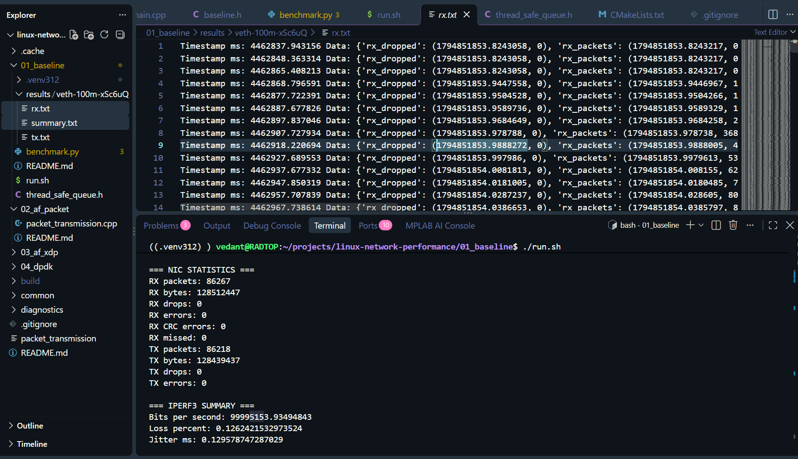

# Stage 1 — Python + iperf3 Baseline

**Status (16 November 2026).** The Python runner completed a 100 Mb/s UDP smoke test over a Linux veth pair. Physical 10 GbE switch testing is planned. This stage provides a UDP/IP reference for [AF_PACKET](../02_af_packet/README.md), [AF_XDP](../03_af_xdp/README.md), and [DPDK](../04_dpdk/README.md).

## 100 Mb/s veth smoke test

The iperf3 client sends from `veth-tx02` in the host's default network namespace to its peer `veth-rx02` in `rxbench-veth-02`. The run used Python 3.12, a 100 Mb/s UDP target rate, and a 10 s test duration.

| Metric | Observed |
| --- | ---: |
| iperf3 reported UDP bitrate | 99.995 Mb/s |
| iperf3 reported UDP loss | 0.126% |
| iperf3 reported UDP jitter | 0.130 ms |
| Interface drops and errors | 0 reported on TX and RX |
| Median gap between logged snapshots | 10.002 ms TX / 9.999 ms RX |
| Longest gap between logged snapshots | 63.932 ms TX / 62.982 ms RX |

Bitrate, loss, jitter, and interface counters come from the [terminal summary](results/veth-100m-xSc6uQ/summary.txt). Snapshot gaps are calculated from adjacent timestamps in the [TX log](results/veth-100m-xSc6uQ/tx.txt) and [RX log](results/veth-100m-xSc6uQ/rx.txt). The script reads iperf3's `end.sum` field. UDP loss measures datagram delivery to the application, while the interface counters report Linux device statistics. The TX and RX snapshots have independent time boundaries, so the packet-total difference cannot quantify UDP loss. These measurements cover the virtual Linux path for one trial.



### Reproduce the run

Install Python 3.12 with venv support, `iperf3`, and `iproute2` on a Linux host. The launcher uses `sudo` to create the veth pair and configure the RX namespace. From the repository root:

```bash
cd 01_baseline
python3.12 -m venv .venv312
.venv312/bin/python3 -m pip install psutil pyroute2
./run.sh
```

[`run.sh`](run.sh) uses fixed interface names and the `172.31.251.0/24` test subnet. It removes leftover interfaces with those names and recreates the named RX namespace, so reserve the names for this test and run one instance at a time. Python 3.12's Linux `fork` default lets workers inherit the current script's stop event. Python 3.14's `forkserver` default requires passing that event explicitly to the workers.

Each run creates `results/veth-100m-*/` with `summary.txt`, `tx.txt`, and `rx.txt`. The launcher prints a `tail -F` command to follow the logs from a second terminal. The monitor writes batches about once per second.

## Planned physical 10 GbE test

The next hardware experiment measures traffic, drops, errors, and timing through two physical NIC ports connected by an external switch.

```text
Linux host / default netns         Same host / rxbench netns
        iperf3 client                    iperf3 server
             |                                ^
           TX NIC                           RX NIC
             |                                ^
             +--> external switch -----------+
```

Candidate ports: Intel X710 `enp23s0f0np0` and `enp23s0f1np1`. Confirm physical cabling, switch forwarding, interface ownership, and addressing before attempting an experiment. A separate RX namespace prevents unintended local IP delivery when both NICs belong to the same machine.

## Current code

The existing [`benchmark.py`](benchmark.py) includes:

- Python CLI for interface names, addressing, RX namespace, bitrate, duration and output files.
- One process per TX/RX interface, with worker threads for `IFLA_STATS64` polling and rtnetlink link-status events.
- A nominal 10 ms monotonic-deadline timer for polling/streaming; worker snapshots are transferred through `multiprocessing.Pipe`.
- Asyncio monitor tasks that drain telemetry from the pipes, buffer samples and periodically append them to disk.
- UDP iperf3 client/server orchestration and initial/final interface counter-delta calculation.
- Events for namespace creation and stream lifecycle.

The runner uses the iperf3 executable for traffic generation and measurement. Reusable orchestration and telemetry can move into [`common/`](../common/README.md) as additional backends mature.

## Requirements and safety

Linux, Python, `psutil`, `pyroute2`, `iperf3`, `iproute2`, `ethtool`, and appropriate permissions for interface/network-namespace configuration.

Read-only checks:

```bash
ip -br address
ip netns list
ethtool -i enp23s0f0np0
ethtool -i enp23s0f1np1
ethtool -S enp23s0f0np0
```

**Example command for the planned physical test.** Use dedicated interfaces and addresses assigned to the test.

```bash
sudo 01_baseline/.venv312/bin/python3 01_baseline/benchmark.py \
  enp23s0f0np0 enp23s0f1np1 \
  --tx-ip 172.31.250.1 --rx-ip 172.31.250.2 \
  --rx-namespace rxbench --bitrate 1G --duration 10
```

The script assigns /24 addresses and can remove an existing namespace named by the CLI. Use a dedicated test namespace and interfaces.

## Measurement and lifecycle limitations

1. **Startup order.** The `namespace_created` event is set after creating the namespace, *before* moving and configuring the RX NIC. A full-interface-ready event, verified listening server, and failed-worker detection are still needed.
2. **First valid sample.** The stream can send initial zero-valued telemetry before the first `IFLA_STATS64` acquisition completes.
3. **End-of-test boundary.** Synchronous event waits inside `async def` can block monitors. The last buffered sample can predate the end of traffic.
4. **Error and cleanup handling.** Add bounded startup waits, worker failure reporting, and explicit handling of iperf3 errors. Snapshot buffers grow throughout the run.
5. **Timing.** Add monotonic timestamps at each counter read to measure collection intervals and missed deadlines independently of snapshot serialization.

## Measurement plan

Collect application UDP throughput, lost datagrams and jitter; Linux NIC counters such as `tx_packets`, `rx_packets`, `tx_dropped`, `rx_dropped`, `rx_errors`, `rx_crc_errors`, and `rx_missed_errors`; link events; and `ethtool -S` / switch-port counters when available.

Counter semantics vary by layer. iperf3 receiver loss is not the same metric as hardware CRC errors or NIC `rx_dropped`. The kernel and NIC may update counters less frequently than polling occurs. Record actual collection timestamps and the offered payload rate versus Ethernet line rate. Integrate physical shaker-table telemetry later for precise mechanical correlation.

## Stage 1 exit criteria

- The 100 Mb/s veth run has a completed summary and TX/RX logs. Repeat at higher rates and check startup, error handling, and shutdown across runs.
- A known switch path is checked physically, not assumed.
- iperf3 completes, and validated before/after counter samples plus reproducible test settings are saved.
- Errors and shutdown do not strand the child processes or damage unrelated network configuration.
- Repeatable tests provide a baseline for [custom raw Ethernet](../02_af_packet/README.md).

Once functional, freeze a known Stage 1 revision for future comparisons. More elaborate error recovery or memory/performance optimization can follow observed problems; basic safety and sample correctness cannot.
