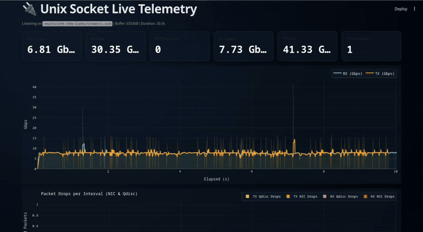

# Linux Network Performance

[Stage 1](01_baseline/README.md) is a Linux benchmark tool for measuring UDP throughput and packet loss across a pair of interfaces. A Python runner starts iperf3, collects interface and queueing-discipline (`qdisc`) counters, and streams them to a local Streamlit dashboard. Use the live TX/RX plots to see when rates diverge, then use the final iperf3 and Linux counters to investigate the loss.

The current setup uses a Linux virtual Ethernet pair. The planned hardware setup sends traffic out one NIC port, through a switch, and back into a second port on the same host. A static run on that path will establish a baseline for future shaker-table testing at 10 GbE.

## Stage 1 dashboard demo

The dashboard plots TX and RX throughput together and shows per-interval interface and qdisc drops below.

[Download the full MP4 (32 seconds)](screenshots/veth-smoke-tests/linux_network_performance_stage1_demo.mp4?raw=true) · [Run Stage 1](01_baseline/README.md#run-the-benchmark-and-dashboard)

## Benchmark and experiments

| Stage | Purpose | Status |
| --- | --- | --- |
| [1. UDP throughput and loss](01_baseline/README.md) | Measure sender bitrate, receiver goodput, and end-to-end UDP loss. Track interface and qdisc counters alongside live throughput. | veth logs and dashboard demo available. Physical switch testing and switch-port telemetry are planned. |
| [2. Raw Ethernet with AF_PACKET](02_af_packet/README.md) | Send and receive test frames directly at Layer 2. Compare application frame counts with Linux interface counters after removing UDP/IP processing from the test path. | C++ sender and receiver with a Python counter harness. |
| [3. AF_XDP](03_af_xdp/README.md) | Investigate shared buffers, descriptor rings, batching, and zero-copy on supported hardware. | Planned. |
| [4. DPDK](04_dpdk/README.md) | Investigate userspace polling and how throughput, loss, and CPU use scale across queues and cores. | Planned. |

## Why investigate the packet path?

Ethernet frames are sufficient to exercise Layer 2 switch forwarding. The Stage 1 UDP workload also traverses IP and UDP on both endpoints and can lose datagrams in the receiver's UDP socket queue. A paced veth run reported [151,980 cumulative UDP receive-buffer errors](01_baseline/README.md#follow-up-rx-udp-receive-buffer-exhaustion-18-november-2026) with zero TX interface drops. Stage 2 removes those protocol layers from the test traffic while keeping the Linux packet-socket, queuing, and driver path in scope. Stages 3 and 4 extend that investigation to packet movement, buffer ownership, and queue processing.

For cross-stage comparisons, match frame size, offered load, duration, and topology. Report achieved throughput, packet rate, loss, and CPU usage by workload. Use receiver loss and host, NIC, and switch-port counters to narrow down where loss occurred, and account for Ethernet overhead when comparing to wire rate.

[Shared architecture](common/README.md) · [Kernel tracing](diagnostics/kernel_tracing/README.md) · [Kernel pktgen](diagnostics/kernel_pktgen/README.md)
